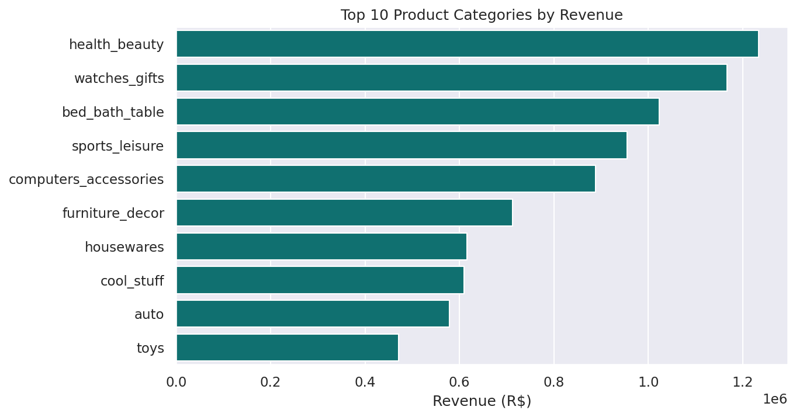
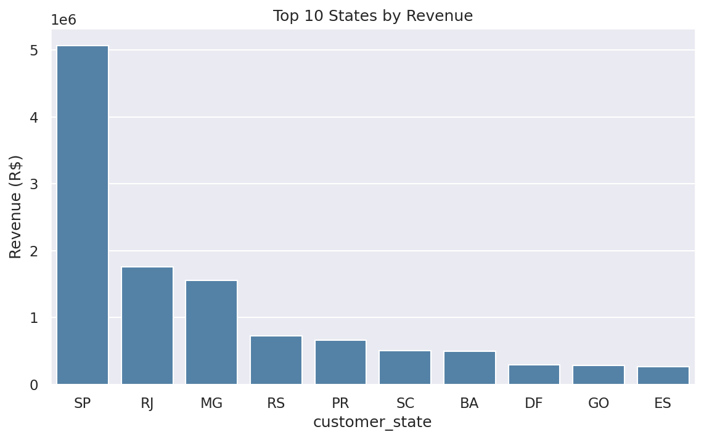
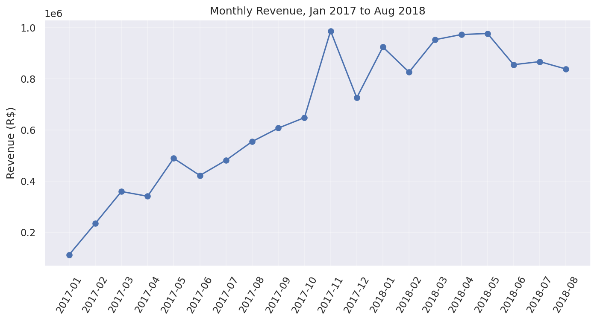
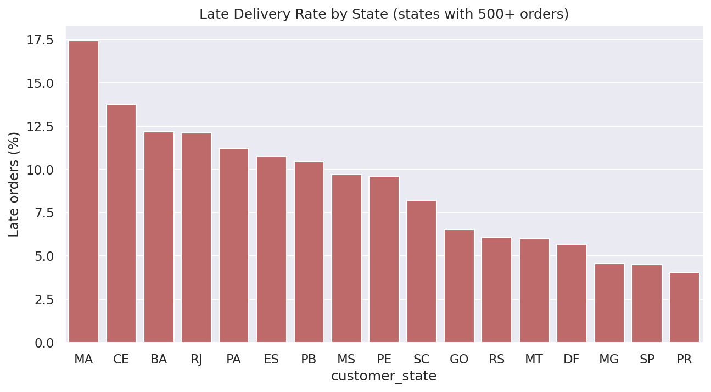
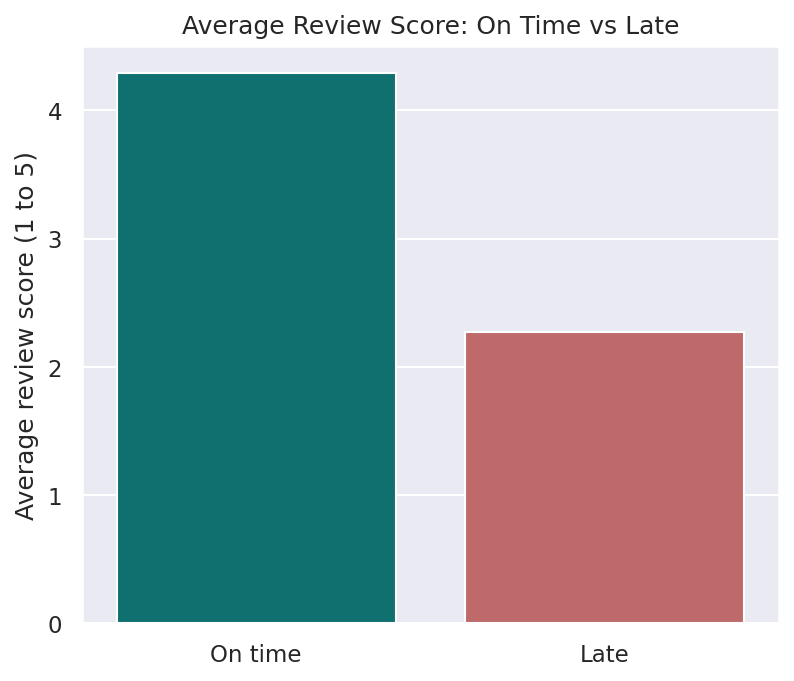
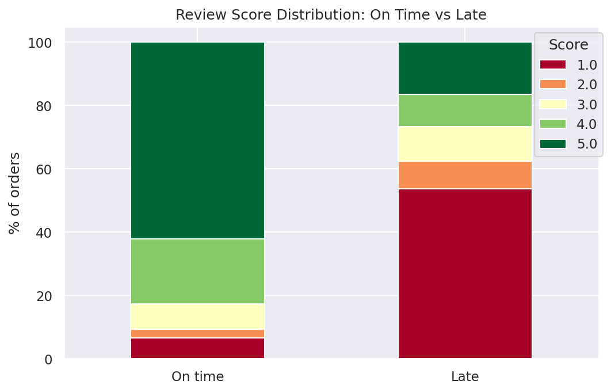

# Olist E-commerce Analysis: Revenue Drivers and the Cost of Late Deliveries

## Business Problem
Olist is a Brazilian e-commerce marketplace. This analysis answers three questions:
1. Which product categories and states drive revenue?
2. How often are orders delivered late, and where?
3. Do late deliveries lower customer review scores, and is the difference statistically real?

## Dataset
[Olist Brazilian E-Commerce](https://www.kaggle.com/datasets/olistbr/brazilian-ecommerce) (Kaggle). About 100K orders from Sep 2016 to Oct 2018, spread across several linked tables. The CSV files are not included in this repository; download them from the link above.

Tables used: orders, order items, products, customers, order reviews, category translation.

## Data Cleaning
| Step | Detail |
|---|---|
| Dates | Converted 3 date columns from text to datetime |
| Order filter | Kept delivered orders with a delivery date: 99,441 → 96,470 (2,971 removed, 3.0%) |
| Reviews | 551 orders had 2+ reviews, so scores were averaged to one per order |
| Categories | 623 products with a missing or untranslated category were labelled `unknown` to keep their revenue |
| Review nulls | 827 item rows have no review score. Left as missing so averages are not distorted |
| Checks | No duplicate orders, customers or item rows. No negative delivery times. No zero or negative prices |

## Methodology
1. Built `delivery_days`, `delay_days` and `is_late` (delivered after the promised date)
2. Merged tables into an item-level table (for revenue) and an order-level table (for delivery and reviews)
3. Analysed revenue by category, state and month
4. Analysed late-delivery rate overall and by state
5. Compared review scores for late vs on-time orders
6. Tested the difference with a Mann-Whitney U test, since review scores are ordinal (1 to 5)

## Key Findings

### Revenue
- Total revenue (item price, excluding freight): **R$ 13.22M** across 110,189 items
- Top categories: **health_beauty, watches_gifts, bed_bath_table**. The top 5 categories make up **39.8%** of revenue and the top 10 make up **62.4%**
- **São Paulo (SP) alone generates 38.3%** of revenue, followed by RJ (13.3%) and MG (11.7%)
- Revenue peaks in **November 2017**, at about R$ 988K

### Delivery
- **6.77%** of delivered orders arrived after the promised date. Median delivery time is 10 days
- The worst states (500+ orders) are **MA (17.4%), CE (13.8%) and BA (12.2%)**, compared with 4.5% in SP. RJ is also high at 12.1%, even though it is in the southeast

### Late Delivery and Reviews
| | Orders | Average review |
|---|---|---|
| On time | 89,443 | **4.29** |
| Late | 6,381 | **2.27** |

- **53.7%** of late orders got a 1-star review, vs **6.6%** of on-time orders
- The difference is statistically significant (Mann-Whitney U, p < 0.001)

## Business Recommendations

1. **Fix delivery reliability in the worst states first.** MA, CE and BA have late rates of 12% to 17%, against 4.5% in SP. Review carrier performance and delivery-date estimates there.
2. **Treat late delivery as the main review risk.** Late orders are only 6.8% of volume but get 1-star reviews more than half the time. Warn customers early when an order is at risk of being late.
3. **Protect the revenue base.** SP and the top 5 categories carry a large share of revenue, and sales peak in November. Plan stock and logistics capacity ahead of the November peak.

## Limitations
- Delivered orders only. Canceled, unavailable and in-transit orders are excluded
- Revenue is item price and excludes freight
- "Late" is measured against Olist's own estimated delivery date
- This shows an association between late delivery and low scores, not proof of cause. Product quality or other factors may also affect both
- The first and last months of the data are incomplete, so the monthly trend uses Jan 2017 to Aug 2018

## Tools
Python, pandas, matplotlib, seaborn, scipy

## How to Run
1. Download the Olist CSV files from Kaggle
2. Set `folder` at the top of the notebook to the folder holding the CSVs
3. Run `olist_ecommerce_analysis.ipynb` from top to bottom. Charts are saved to `charts/`

## Author
**Awan Mansuri** | [LinkedIn](https://www.linkedin.com/in/awan-mansuri) | [GitHub](https://github.com/awan-mansuri)
